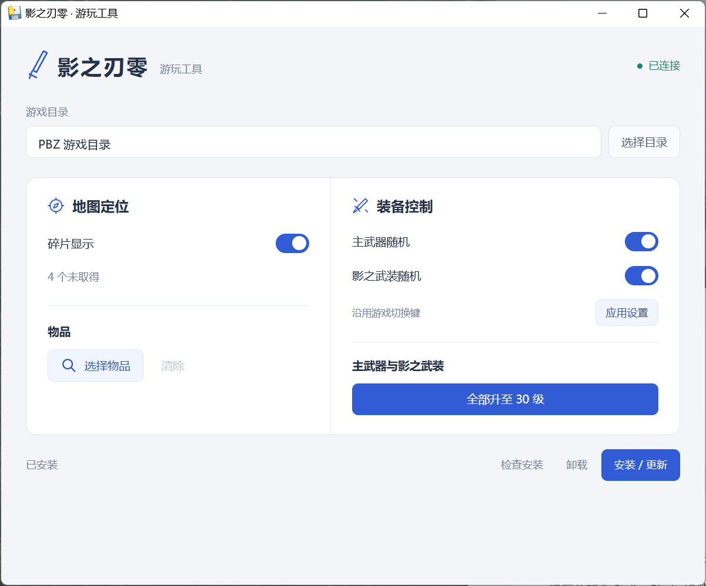

# 影之刃零 · 游玩工具



## 功能

- **随机换武器**：使用游戏原切换键，从已拥有、未锁定的主武器中随机准备下一把；影之武装可以单独开启随机。
- **碎片地图定位**：显示尚未取得的杀气琥珀与黑石碎片，包含未探索区域；地图使用游戏物品原图标，大小跟随铃铛。用鼠标选点后，回场景查看方向与距离。
- **装备升级**：一键把已拥有的主武器与影之武装升至 30 级，特殊装备遵循游戏原上限。

## 使用

1. 退出游戏，打开 `PBZ-PlayTools.exe`，选择游戏目录，点击「安装 / 更新」。
2. 进入存档，等待工具显示「已连接」。
3. 随机装备：开启相应开关，点「应用设置」，继续使用游戏原切换键。
4. 找碎片：打开「碎片显示」，在区域详细地图用鼠标点击碎片图标；关闭地图后跟随指引，再点同一图标取消追踪。

安装和更新需要退出游戏；安装完成后，功能开关可在游戏运行时调整。地图暂不支持手柄选点。其他物品的位置查找仍在完善，本版演示主要介绍碎片和随机装备。

当前版本 **0.6.3**，适配 Steam build **26367565**。工具安装 UE4SS 和 Lua 插件，通过游戏子系统切换装备、查询地图与保存状态，不直接改写游戏 EXE。界面使用本地 WebView2。

## 从源码构建

Windows 下安装 Python 3.10+ 和 Git，在项目根目录执行：

```powershell
py -3 -m venv manager/.venv
manager/.venv/Scripts/python.exe -m pip install -r manager/requirements.txt
manager/.venv/Scripts/python.exe build_mod.py
./manager/build.ps1
manager/.venv/Scripts/python.exe package_release.py
manager/.venv/Scripts/python.exe package_source.py
```

EXE 位于 `manager/dist/0.6.3-ue4ss/`，发布 ZIP 与源码包位于 `dist/`。源码 ZIP 解压后已包含框架运行文件，可以直接构建 EXE；制作源码 ZIP 本身需要 Git 工作副本。

目录：`lua/` 为游戏插件，`manager/` 为桌面工具，`vendor/ue4ss/` 为随包框架，`docs/` 为说明素材。第三方许可见 [THIRD_PARTY_NOTICES.md](THIRD_PARTY_NOTICES.md)。
